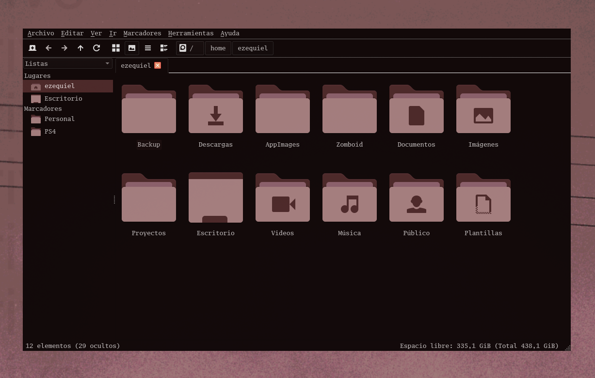

# noctalia-dynamic-icons

Dynamic icons for GTK file managers (Nemo, Thunar, Nautilus, Caja). These scripts allow you to easily apply dynamic icons across different desktop environments.

---

## Available Themes

### Papirus

To install the Papirus theme, run the following command:
```bash
bash (curl -fsSL https://raw.githubusercontent.com/ezequielgk/noctalia-dynamic-icons/main/papirus.sh | psub)
```

---

### Colloid 

*Currently under maintenance. Use with caution.*

```bash
bash (curl -fsSL https://raw.githubusercontent.com/ezequielgk/noctalia-dynamic-icons/main/colloid.sh | psub)
```

---

### Flat-Remix

To install the Flat-Remix theme:

```bash
bash (curl -fsSL https://raw.githubusercontent.com/ezequielgk/noctalia-dynamic-icons/main/flat-remix.sh | psub)
```

---

### Tela
```bash
bash (curl -fsSL https://raw.githubusercontent.com/ezequielgk/noctalia-dynamic-icons/main/tela.sh | psub)
```

---

### Reversal
```bash
bash (curl -fsSL https://raw.githubusercontent.com/ezequielgk/noctalia-dynamic-icons/main/reversal.sh | psub)
```

---

### Zafiro
```bash
bash (curl -fsSL https://raw.githubusercontent.com/ezequielgk/noctalia-dynamic-icons/main/zafiro.sh | psub)
```

---
