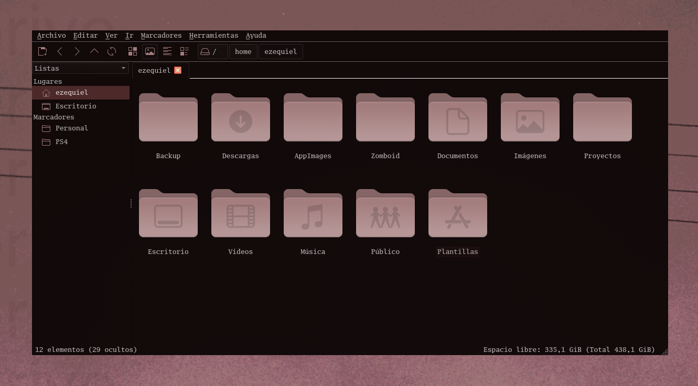
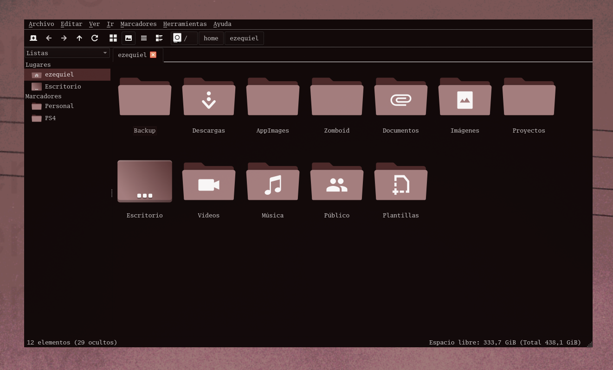
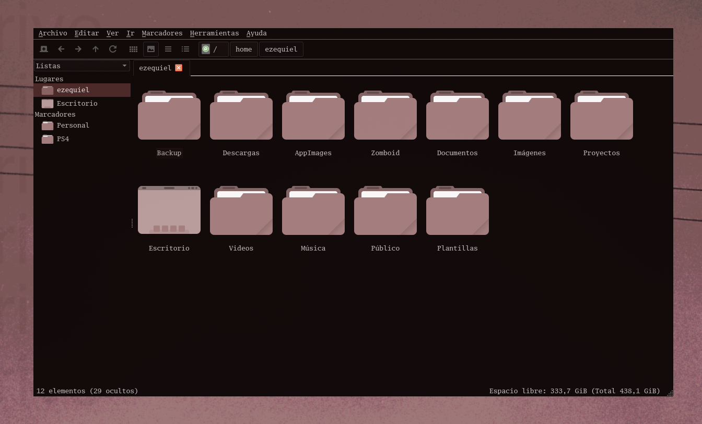
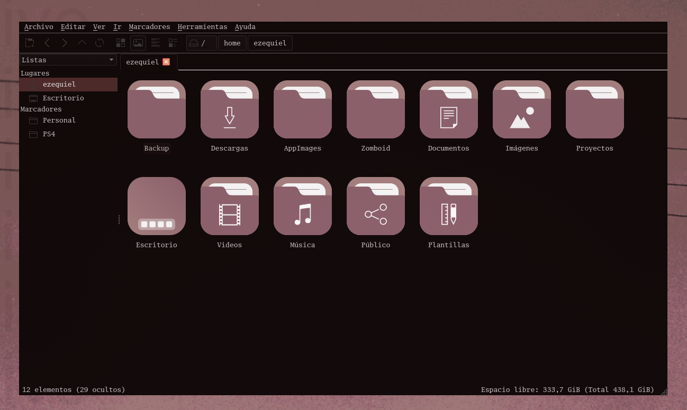
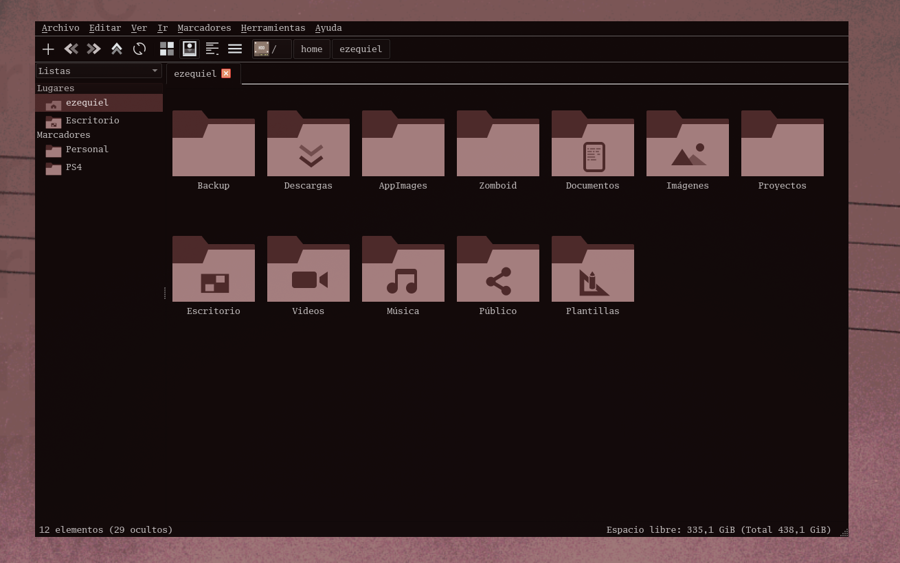

# noctalia-dynamic-icons

Dynamic icons for GTK file managers (Nemo, Thunar, Nautilus, Caja). These scripts allow you to easily apply dynamic icons across different desktop environments.

---

## Available Themes

### Papirus

```bash
curl -fsSL https://raw.githubusercontent.com/ezequielgk/noctalia-dynamic-icons/main/papirus.sh | bash
```

---

### Colloid 

```bash
curl -fsSL https://raw.githubusercontent.com/ezequielgk/noctalia-dynamic-icons/main/colloid.sh | bash
```

---

### Flat-Remix

```bash
curl -fsSL https://raw.githubusercontent.com/ezequielgk/noctalia-dynamic-icons/main/flat-remix.sh | bash
```

---

### Tela

```bash
curl -fsSL https://raw.githubusercontent.com/ezequielgk/noctalia-dynamic-icons/main/tela.sh | bash
```

---

### Reversal

*Currently under maintenance. Use with caution.*

```bash
curl -fsSL https://raw.githubusercontent.com/ezequielgk/noctalia-dynamic-icons/main/reversal.sh | bash
```

---

### Zafiro

```bash
curl -fsSL https://raw.githubusercontent.com/ezequielgk/noctalia-dynamic-icons/main/zafiro.sh | bash
```
